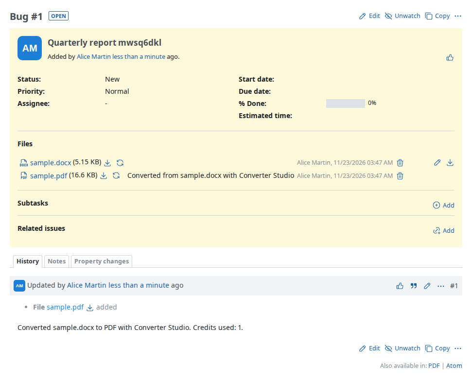
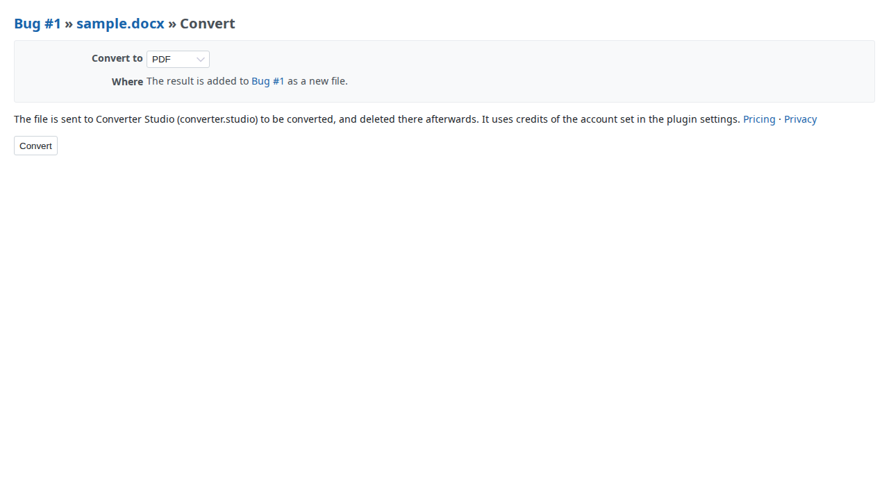
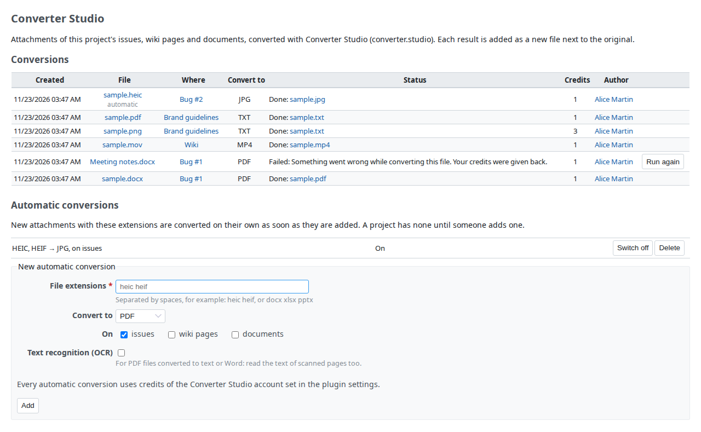

# Converter Studio for Redmine

Convert the files attached to Redmine issues, wiki pages and documents with
[Converter Studio](https://converter.studio): Word, Excel and PowerPoint files to PDF, iPhone photos
(HEIC) to JPG, scans and pictures to text (OCR), videos to MP4, and the other conversions
Converter Studio offers. The conversion runs on Converter Studio's servers, so there is nothing to
install on yours: no LibreOffice, no ImageMagick, no FFmpeg, no Tesseract.

- A **"Convert…"** link next to each attachment opens a page with the formats that file can
  become. The result is added as a **new attachment** on the same issue, wiki page or document,
  next to the original. On an issue, a **journal entry** says what was converted and what it
  cost, or why it failed.
- Conversions run in the **background** (Active Job), so nobody waits for a video to finish.
- **Automatic conversions** per project, off until someone adds one: for example, every HEIC photo
  attached to an issue becomes a JPG.
- A **project module** and two **permissions** decide who may use it.
- A project page lists the **conversions** with their status, cost and, for a failure, Converter
  Studio's own reason, where a failed conversion can be run again.



## Requirements

- Redmine **5.0 or newer**: 7.0, 6.1, 6.0, 5.1 or 5.0 (Debian 13 ships 6.0, Debian 12 ships 5.0),
  with a Ruby that version supports, on any of Redmine's databases. The plugin is tested on the
  newest release of each: 7.0.3 and 6.1.6 on Ruby 3.4, 6.0.12 on Ruby 3.3, 5.1.13 on Ruby 3.2 and
  5.0.14 on Ruby 3.1.
- A Converter Studio account and an API key. Free accounts get credits every day; most documents
  and photos cost 1 credit, reading the text of a picture (OCR) a little more; audio and video are
  priced by their length (video also by its frame size and the format made). See
  [pricing](https://converter.studio/pricing).
- Redmine must be able to reach `https://converter.studio` (outgoing HTTPS; Ruby's usual
  `https_proxy` environment variable is honoured).

The plugin has no gems of its own.

## Installation

The plugin's folder must be named `redmine_converter_studio`:

```console
$ cd /path/to/redmine/plugins
$ git clone https://github.com/tariksucu/redmine_converter_studio.git
$ cd ..
$ bundle exec rake redmine:plugins:migrate NAME=redmine_converter_studio RAILS_ENV=production
```

Restart Redmine. The plugin appears in **Administration » Plugins**.

To update it, replace the folder (or `git pull` in it), run the same `redmine:plugins:migrate`
command and restart Redmine.

To remove it: `bundle exec rake redmine:plugins:migrate NAME=redmine_converter_studio VERSION=0
RAILS_ENV=production`, delete the folder and restart. The files it added to issues stay where they
are.

## Configuration

1. Create an API key on your Converter Studio [account page](https://converter.studio/account#api-keys)
   (keys start with `cvs_live_`; keep them secret).
2. In **Administration » Plugins » Converter Studio » Configure**, paste the key and click
   **Apply**. The page then shows the account it is connected to and the credits left, or Converter
   Studio's reason when the key does not work.
3. In each project that should use it, tick **Converter Studio** under **Settings » Modules**.
4. In **Administration » Roles and permissions**, give **Convert attachments** to the roles that may
   convert, and **Manage automatic conversions** to those that may set up automatic conversions.

| Setting                                 | Default                        | What it does                                               |
| --------------------------------------- | ------------------------------ | ---------------------------------------------------------- |
| API key                                 | none                           | your Converter Studio API key                              |
| API address                             | `https://converter.studio/api` | where the API is                                           |
| Most credits a file may cost on its own | `20`                           | a dearer conversion waits until someone approves its price |

### How the API key is stored

- The settings page never shows the key. Leaving the field empty keeps the saved key; **Remove the
  saved key** deletes it.
- The key is encrypted in Redmine's database with Redmine's own `database_cipher_key` (set in
  `config/configuration.yml`), the way Redmine keeps LDAP and repository passwords. Without a
  cipher key, it is stored as plain text (the settings page says which); after adding a cipher
  key, open the settings page and click **Apply** to encrypt the saved key.
- Or set the `CONVERTER_STUDIO_API_KEY` environment variable for Redmine's processes (web server
  and job workers): it wins over a saved key, and no key needs to be saved in the database.
- The key is sent only to the API address, and never written to a log.

## Converting a file

Click the **Convert…** icon next to an attachment (on the issue, the wiki page, the document, or
the attachment's own page). Pick the format and click **Convert**:



- The formats offered are those Converter Studio converts that file to right now.
- A picture to **Text** or **Word** is read with text recognition (OCR). For a **PDF**, tick **Text
  recognition (OCR)** to read scanned pages too.
- The new file is named after the original (`report.docx` → `report.pdf`) and its description says
  where it comes from. Reload the page after a moment to see it.
- On an issue, the journal entry names the converted file and the credits used; a failure is
  written there too, with Converter Studio's reason ("This file is damaged…", "You have used
  today's credits…"). On wiki pages and documents, which have no journal, the reason is shown next
  to the file and on the project's Converter Studio page.

Who may convert: users whose role has **Convert attachments** in a project with the module, who can
see the file and may add files to that issue (edit it or add notes), wiki page (edit it) or document
(add or edit documents).

## The project's Converter Studio page

The **Converter Studio** tab of a project lists its conversions (the last hundred) with their
status, cost and author. A failed conversion has **Run again**; one that costs more than the limit
has **Approve … credits and convert** (nothing is charged before that).



### Automatic conversions

Below the list, roles with **Manage automatic conversions** add rules: the file extensions
(`heic heif`, `docx xlsx pptx`…), the format made, and where (issues, wiki pages, documents).
A project has none until someone adds one. When a matching file is attached, it is converted on its
own, with the same journal entry, as the user who attached it. A file named like the result already
there (an issue copied with its files) is not converted again, nor is a converted file.

## Background jobs

Conversions run through Active Job with the queue adapter Redmine is configured with. Each
conversion's row in Redmine's database keeps how far it got (the upload, the conversion started at
Converter Studio), so nothing is uploaded or charged twice: a run that starts again goes on where
the last one stopped, and a repeated start gets the first conversion back (the API's
`Idempotency-Key`).

- **Redmine's default adapter (`async`)** runs conversions in threads of the web server process, so
  a restart (a deploy, an update, a crash) stops the ones it was running. After a restart, Redmine
  picks them up on its own: after the requests it serves, each process looks (at most once a
  minute) for conversions nobody is working on any more and runs them again from where they
  stopped. A conversion that was running is free to take two minutes after its last sign of life
  at most, so it goes on a few minutes after Redmine is back and someone opens a page.
- **A persistent adapter** with its worker keeps the jobs over a restart, and runs them in the
  worker instead of the web server, for example
  [Sidekiq](https://github.com/sidekiq/sidekiq/wiki/Active-Job),
  [Solid Queue](https://github.com/rails/solid_queue) or [GoodJob](https://github.com/bensheldon/good_job)
  (PostgreSQL): add the gem to Redmine's `Gemfile.local`, set it in
  `config/additional_environment.rb` (`config.active_job.queue_adapter = :sidekiq`), and start the
  worker with the same environment as the web server. Conversions use the `default` queue. If a
  worker is killed in the middle of a job, run the conversions it lost with
  `bundle exec rake redmine:converter_studio:resume RAILS_ENV=production` (from cron, if you like).
- A conversion nobody has worked on for 30 minutes also gets **Run again** on the project page.

A long conversion (a video) waits two minutes in one job run, then hands over to a new run, so it
never holds a worker for long. A run holds its conversion while it works, so two runs never work
on one conversion at once.

## Limits

- The largest file depends on your Converter Studio plan; files over 95 MB are uploaded in parts.
  The result must fit Redmine's **Maximum attachment size** (Administration » Settings » Files) and
  its allowed extensions, otherwise the conversion fails with that reason.
- One file in, one file out: no merging or splitting of PDFs.
- Attachments of news, forums and the project's Files area are not offered.
- A conversion takes at most three hours.
- Results are kept on converter.studio for 6 hours: a conversion that cannot add its result in that
  time has to run again.

## Translations

The plugin's texts are in `config/locales/en.yml`. A translation is a copy of that file named after
Redmine's language code (`de.yml`, `fr.yml`, `pt-BR.yml`…) with the values translated; English is
used for any text a translation lacks. Contributions are welcome.

## Privacy

The files you convert (and their names) are sent to Converter Studio (converter.studio) to be
converted; nothing else about your Redmine or its users is sent. Uploaded files are deleted as soon
as they are converted, and results 6 hours later. Each request also names the plugin
(`X-Converter-Studio-Client: redmine/<version>`), for usage statistics only. Mention Converter
Studio in your privacy policy if your users' files are converted. In Redmine, the plugin keeps a
list of the conversions (file name, format, status, cost, who asked) until it is uninstalled. See the
[privacy policy](https://converter.studio/privacy) and the [terms](https://converter.studio/terms).

## Development

The tests run in Redmine's own test framework, against a small stand-in for the API:

```console
$ cd /path/to/redmine
$ RAILS_ENV=test bundle exec rake redmine:plugins:migrate
$ RAILS_ENV=test bin/rails redmine:plugins:test NAME=redmine_converter_studio
$ cd plugins/redmine_converter_studio && bundle exec rubocop $(git ls-files '*.rb' '*.rake')
```

RuboCop uses Redmine's own configuration (the file names are given because Redmine's configuration
leaves plugins out).

## Links

- Converter Studio: <https://converter.studio>
- API documentation: <https://converter.studio/developers>
- Pricing: <https://converter.studio/pricing>
- Source code and issues: <https://github.com/tariksucu/redmine_converter_studio>
- Changelog: [CHANGELOG.md](CHANGELOG.md)
- Support: <support@converter.studio>

## Licence

Copyright © 2026 Converter Studio. GNU General Public License, version 2 or (at your option) any
later version, like Redmine itself: see [LICENSE](LICENSE).
